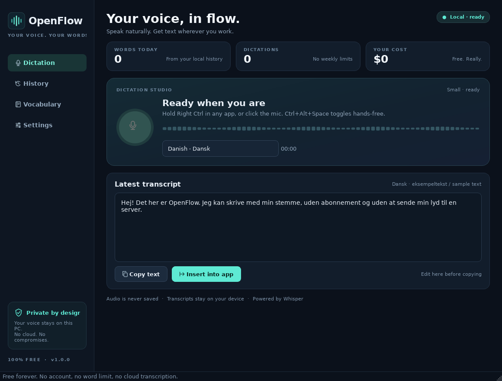

# OpenFlow

**Free, local voice typing for Windows. Danish by default. 100 language choices. No account, subscription, API key or word limit.**

OpenFlow is an independent, open-source alternative inspired by the Wispr Flow dictation workflow. It is not affiliated with Wispr or OpenAI. It uses OpenAI's open Whisper models through `whisper.cpp`, entirely on your CPU.

[Dansk vejledning](docs/DA.md)



*Interface preview with sample Danish text. Your own transcripts are produced locally from your microphone.*

## Download for Windows

Download **`OpenFlow.exe`** from the [GitHub Release](https://github.com/Antoniscool123/Whisper/releases/latest).

- Windows 10 or 11, **64-bit Intel/AMD**. No Python installation needed.
- The executable is portable: put it in a folder you own and double-click it.
- On first launch, click **Download model**. The recommended Small model is approximately **181 MB**. This one-time download is free and resumable.
- After the model is downloaded and verified, disconnect from the internet if you like: recording, transcription, vocabulary and pasting still work.
- Allow microphone access in **Windows Settings → Privacy & security → Microphone**.
- The build is not code-signed. Windows SmartScreen may show an “unknown publisher” warning. Verify the release checksum and source before choosing **More info → Run anyway**; do not disable your antivirus.

The model is deliberately not bundled into the executable, keeping the download small. Nothing in the app expires or requires payment.

## Use it

1. Open OpenFlow and download/load the Small model.
2. Keep **Danish · Dansk** selected, or choose another language / **Auto-detect**.
3. Click in the app where you want text: an email, document, chat, editor, browser field, etc.
4. **Hold Right Ctrl**, speak, then release. OpenFlow transcribes and inserts the text.
5. Alternatively, click the mic button, speak, and click again to stop.

### Shortcuts

| Action | Shortcut |
|---|---|
| Hold to dictate | **Right Ctrl** (configurable) |
| Toggle hands-free dictation | **Ctrl + Alt + Space** |
| Cancel recording / transcription | **Ctrl + Alt + Escape** |
| Paste a copied transcript manually | **Ctrl + V** |

Other hold shortcuts: Ctrl+Win, Ctrl+Shift, or F8. Right Ctrl is the default to reduce shortcut conflicts and avoids Danish AltGr (Ctrl+Alt) combinations.

OpenFlow remembers the window where you started speaking. If focus changes while you speak, it **copies instead of pasting into the wrong app**. You can edit the transcript in OpenFlow and use **Insert into app** to return to the previous external window. Text insertion uses the clipboard and sends Ctrl+V; the previous *text* clipboard is restored when possible. Clipboard managers may retain copied text, and non-text clipboard contents cannot be restored.

Apps running as administrator may block input from a normal-integrity process. Run OpenFlow at the same privilege level if necessary. Some apps/games with custom input handling may not accept synthetic Ctrl+V.

## Languages

The language picker contains **100 Whisper language choices**, including:

- **Danish**, English, German, Swedish, Norwegian, Norwegian Nynorsk, Icelandic and Faroese
- Dutch, French, Spanish, Italian, Portuguese, Polish, Ukrainian and Russian
- Arabic, Hebrew, Hindi, Bengali, Tamil, Turkish and Persian
- Chinese, Cantonese, Japanese, Korean, Indonesian, Vietnamese and Thai
- Many more African, European and Asian languages

Choose a known language for the most reliable result. Auto-detect uses the first 30 seconds and can be less reliable for short clips, similar languages, heavy accents or code-switching. Larger models generally improve accuracy. Whisper's accuracy varies substantially by language and audio quality; 100 choices does **not** mean equal accuracy in every language. The interface itself is English with native-language names in the picker; speech input is multilingual.

## Features

- Unlimited local dictation; no weekly allowance or paid tier
- Hold-to-talk and hands-free recording, live input meter, cancellation
- Danish-first defaults and multilingual Whisper models
- Automatic punctuation from Whisper; conservative hesitation cleanup (`øh`, `øhm`, `um`, `uh`, etc.)
- Optional spoken commands in Danish and English: `punktum`, `komma`, `spørgsmålstegn`, `nyt afsnit`, `ny linje`, `new paragraph`, `question mark`, and more
- Personal dictionary (`spoken text => written text`) and recognition hints for names/jargon
- Focus-aware insertion into other Windows apps, manual copy/paste fallback
- Editable latest transcript and up to 100 local history entries
- System tray, optional Windows sign-in startup, microphone selection
- Seven model choices from Tiny to Large v3; CPU thread control
- Resumable model downloads, pinned repository revisions and SHA-256 verification
- No screenshots, screen reading, cloud transcription, advertising or analytics

### What this does not claim to copy

This is a free dictation alternative, **not a pixel-for-pixel or feature-for-feature clone** of a proprietary product. It does not include cloud LLM rewriting, “make this professional” commands, screen-context awareness, mobile apps, team administration or cloud sync. Cleanup is deterministic and conservative; it does not invent or rephrase your content. Transcription finishes after you stop recording rather than streaming partial words.

## Models and memory

Sizes below are approximate download sizes, not RAM usage. Quantized models trade a small amount of accuracy for much less disk space.

| Model | Download | Suggested use |
|---|---:|---|
| Tiny Q5 | ~31 MB | Fast tests / very old PCs; lower accuracy |
| Base Q5 | ~57 MB | Lightweight dictation |
| **Small Q5 (default)** | **~181 MB** | Good Danish/multilingual starting point |
| Small full precision | ~466 MB | Non-quantized small model |
| Medium Q5 | ~514 MB | More accuracy, slower CPU inference |
| Large v3 Turbo Q5 | ~547 MB | Broad multilingual coverage, faster large-family decoder |
| Large v3 Q5 | ~1.1 GB | Difficult audio; highest accuracy option, more RAM |

Start with Small. If Danish names or difficult audio are inaccurate, try Medium or Large v3 and add recognition hints. CPU speed depends on your processor, model and recording length; there is no guaranteed real-time speed. Allow several GB of free RAM for larger models. This Windows release uses CPU inference, not CUDA/Metal/DirectML.

Each recording is capped at **10 minutes** to bound memory use. Audio is captured as 16 kHz mono float samples in memory and is not written to a WAV file.

## Privacy and storage

- Microphone audio: **memory only**, discarded after transcription/cancellation.
- Transcription: local `whisper.cpp`; no audio or transcript is sent to a server.
- Internet: used only when you explicitly download a model from the official `ggerganov/whisper.cpp` Hugging Face repository.
- History: optional, local, bounded to 100 entries. Turn it off in Settings; clearing history deletes saved entries.
- Vocabulary and settings: local JSON files.
- Logs: rotating technical logs; transcript text is not intentionally logged.
- Windows startup: opt-in, using the current user's `HKCU\...\Run` registry key. No service or administrator install is required.
- Clipboard: dictated text is temporarily placed on the Windows clipboard for insertion. Other clipboard tools can observe/retain it.

Files on Windows:

```text
%APPDATA%\OpenFlow\settings.json
%APPDATA%\OpenFlow\history.json
%APPDATA%\OpenFlow\openflow.log
%LOCALAPPDATA%\OpenFlow\models\ggml-*.bin
```

Use **Settings → Open data folder**. Remove models through Settings before deleting their files manually. Uninstalling is deleting the executable and, if desired, these folders; disable startup in Settings first.

## Run from source

Use **64-bit Python 3.11** on Windows for the full global-shortcut and paste experience:

```powershell
py -3.11 -m venv .venv
.\.venv\Scripts\Activate.ps1
python -m pip install -r requirements.txt
python app.py
```

The core also runs on Linux for development with a compatible desktop/audio environment; global shortcuts and automatic insertion are Windows-specific there. macOS is not a supported release target.

## Build the real `.exe`

From the repository root in Windows PowerShell:

```powershell
.\scripts\build_windows.ps1
```

This installs the pinned build dependencies, generates the original icon, and runs PyInstaller. Output:

```text
dist\OpenFlow.exe
dist\SHA256SUMS.txt
```

The GitHub Actions workflow builds on `windows-latest`, runs tests, downloads a free Tiny model and transcribes a public English sample through the real native engine, builds the executable, then launches the packaged executable in smoke-test and Qt-render modes. It uploads the executable and checksum as an artifact and can publish a GitHub Release via manual dispatch.

Verify a downloaded release:

```powershell
Get-FileHash .\OpenFlow.exe -Algorithm SHA256
# Compare with SHA256SUMS.txt from the same release.
```

## Tests

```powershell
python -m pip install -r requirements-dev.txt
python -m pytest
python -m ruff check openflow app.py scripts tests --select E9,F63,F7,F82
python scripts/integration_test.py  # downloads a free Tiny model and a public audio sample
```

Automated coverage includes Danish text cleanup, Unicode vocabulary, settings/history persistence, all language codes, hotkey state transitions, checksum/resume behavior, bounded memory recording and the transcription adapter. CI additionally exercises native English speech recognition and packaged Windows dependencies. Physical microphone quality, global hooks in third-party apps and clipboard behavior still need a manual Windows check; CI cannot prove every app accepts pasted input.

Manual release checklist: Danish microphone dictation; auto-detect; hold/release; hands-free toggle; cancel; focus-change safety; Notepad and browser insertion; clipboard restoration; tray/reopen; offline restart after model download; startup opt-in/out.

## License and acknowledgements

OpenFlow's original code and icon are MIT licensed. See [LICENSE](LICENSE) and [THIRD_PARTY_NOTICES.md](THIRD_PARTY_NOTICES.md). Built with [whisper.cpp](https://github.com/ggml-org/whisper.cpp), [pywhispercpp](https://github.com/absadiki/pywhispercpp), [OpenAI Whisper models](https://github.com/openai/whisper), Qt/PySide6, NumPy, sounddevice/PortAudio and PyInstaller. Model weights are downloaded separately from [ggerganov/whisper.cpp](https://huggingface.co/ggerganov/whisper.cpp).

### Floating dictation status

OpenFlow displays a small non-interactive status indicator above normal windows without taking focus. Turn it off in Settings → Recording & text insertion. Focus the destination text field before using the shortcut. Automatic paste is best effort: elevated apps, secure fields, games, terminals, and apps that intercept Ctrl+V may not accept it. If focus changes during dictation, OpenFlow copies the transcript instead of pasting into the wrong window.

### Speed and accuracy

Short recordings use an experimental shorter Whisper encoder context by default. This can speed up processing but can also change accuracy; disable **Faster short recordings** under Settings → Speech to use the full context. Recordings over 26 seconds always use the full context. Quiet but audible input is gently amplified (at most 4×) without clipping; this cannot remove background noise. For Danish choose **Danish**, not auto-detect, to avoid an additional language-identification pass. Small is the quality/speed compromise; try Base for speed or Medium for quality, at the cost of speed. Preload avoids repeatedly loading the model. On a four-core CPU, start with four threads. Performance depends on audio, hardware, power mode and other workloads.
